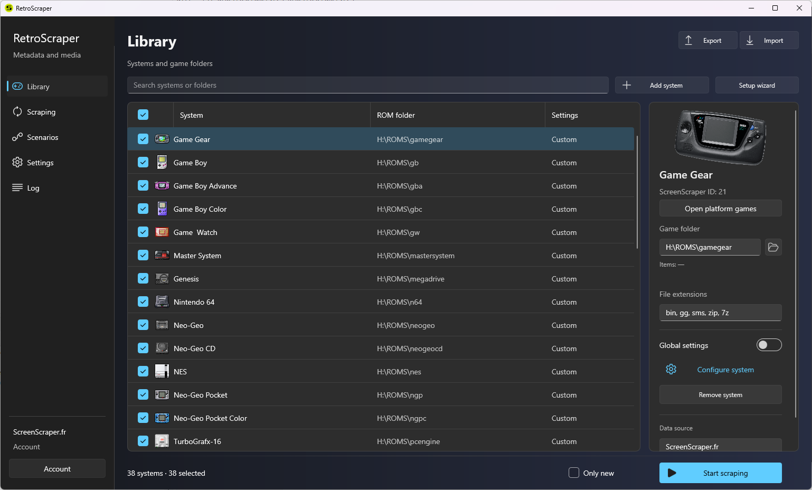
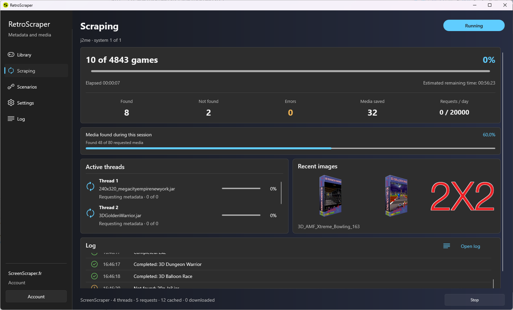
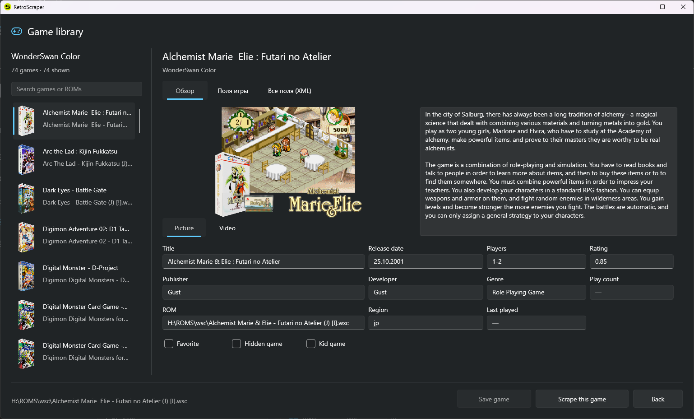

# RetroScraper

RetroScraper is a desktop application for organizing retro game collections. It downloads game descriptions, covers, screenshots, videos, and other media from ScreenScraper and saves them alongside game lists for supported gaming frontends.

## Features

- A library of platforms and ROM folders, game search, and a guided setup wizard.
- Support for EmulationStation, Recalbox, and LaunchBox.
- Metadata and media downloads with language and region preferences, plus composite MIX images with a preview.
- Game details, individual field, and XML editing, with a backup created when saving changes.
- Scenarios for updating a selected field across multiple platforms, either filling missing values or forcing an update.
- Shared and per-platform settings, configurable caching, and scraping logs.
- Interface translations in English, Russian, German, Spanish, French, Italian, and Portuguese.

To get started, add platforms and game folders using the setup wizard, configure your ScreenScraper connection, and choose the metadata and media you want to download. Content availability and request limits depend on ScreenScraper.

## Screenshots

Platform library:

Scrapping process:

Platform editing:

